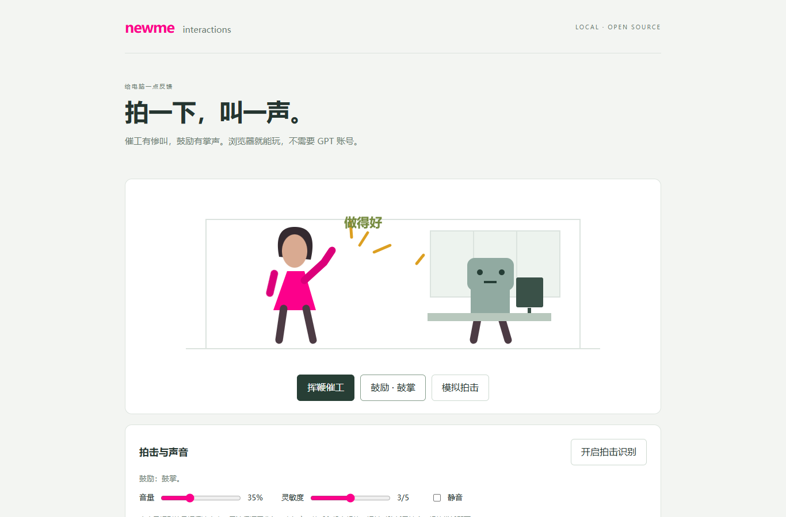

# newme interactions

拍一下电脑，电脑叫一声；点“挥鞭催工”播放卡通惨叫，点“鼓励”播放掌声。

从 newme office 中独立出来的互动组件。**不需要 GPT、Codex、模型账号或 API Key**。浏览器负责麦克风识别和音效，Node.js 只提供本机页面与可选反馈转发。



## 直接运行

安装 [Node.js 22 或更新版本](https://nodejs.org/)，然后：

```sh
git clone https://github.com/69755354/newme.git
cd newme/skills/newme-interactions/assets/app
npm start
```

在浏览器打开 **http://127.0.0.1:4320/**。不需要 `npm install`。

- Windows：也可以双击 `start-windows.cmd`。
- macOS / Linux：可以运行 `sh start-macos.command`。
- 先点“挥鞭催工”和“鼓励 · 鼓掌”体验声音、动画。拍击识别默认关闭，点“开启拍击识别”后由浏览器请求麦克风权限。
- 停止识别或关闭页面会释放麦克风；本地服务用 Ctrl+C 停止。

## 有什么

| 操作 | 效果 |
| --- | --- |
| 麦克风识别到短促冲击声 | 播放卡通惨叫，触发挥鞭动画，可按选择转发“不满意” |
| 挥鞭催工 | 鞭响 + 卡通电子惨叫；不发送返工要求 |
| 鼓励 | 掌声；不发送返工要求 |
| 模拟拍击 | 测试声音与动画；不发送返工要求 |
| 音量、灵敏度、静音 | 现场调整，静音会停止正在播放的声音 |

音效由仓库内脚本合成，不使用人声录音或声音克隆。头像是通用 SVG。这里发布的是互动模块，不包含原办公室场景、个人定制人物和任务监控。

## 识别原理和边界

`AudioWorklet` 在浏览器音频线程里分析 RMS 突增、上升速度、衰减时间、峰均比和低频占比，带环境基线和冷却时间。播放音效时短暂抑制识别，减少扬声器回授。

这是一种**声音启发式识别**，不是机身加速度传感器。打字、拍手、桌面碰撞都有可能误触；换设备后需要调整灵敏度。自动测试覆盖合成冲击、持续音、低强度键盘型声音及冷却逻辑；没有跨设备准确率保证。轻拍掌托即可，不需要用力敲屏幕。

音频仅在本机计算，不保存录音，不把麦克风音频传给服务端。反馈转发只发送你在文本框里填写的要求和事件 ID。

## 接自己的 AI / 工具

默认是**本地示例模式**：按钮能玩，本地接收反馈，但不启动任何 AI 工作。

如果你有自己的 HTTP 接收器，在启动前配置：

```sh
# macOS / Linux
NEWME_FEEDBACK_URL=https://your-adapter.example/feedback npm start
```

```powershell
# Windows PowerShell
$env:NEWME_FEEDBACK_URL = 'https://your-adapter.example/feedback'
npm start
```

需要认证时，用环境变量 `NEWME_FEEDBACK_TOKEN`；它只在本机服务端使用，不放进网页或 Git。`.env.example` 只是配置示例，程序不会自动加载 `.env`。

在页面勾选“拍击时自动发送”之后，真实识别事件会把返工要求送到接收器。页面只报告**接收器已接受**，不会把 HTTP 200 当成 AI 已经修好工作。接收器负责选择任务、授权、繁忙任务排队和调用实际工具。网络结果未知时本应用不自动重试。

这版没有内置 Claude、Cursor 或其他编辑器的专用适配器。详细事件结构和前端接入方式见 [INTEGRATION.md](INTEGRATION.md)。

## 开发

```sh
npm test
npm run sounds
```

```text
public/interactions.js    可复用的声音与麦克风控制器
public/slap-detector.js   纯音频检测算法
public/slap-worklet.js    音频线程桥接，不传出音频样本
public/app.js            独立演示页面
public/sounds/           两段惨叫和一段掌声
server.mjs               仅监听 127.0.0.1；静态白名单 + 可选反馈转发
scripts/make-sounds.mjs   可复现音效生成器
tests/                   检测、资源边界、反馈与取消操作测试
```

服务端只监听本机环回地址，不要直接暴露到公网。麦克风功能请使用 localhost / 127.0.0.1 或你自己配置的 HTTPS，不要直接双击 HTML 文件。

## English

A small, framework-free interaction kit: microphone impulse detection, a comic whip/yelp reaction, applause, SVG animation, and an optional feedback webhook. No GPT account, model SDK, or runtime npm dependencies. Requires Node.js 22+ and a modern browser with AudioWorklet support.

Run `npm start`, then open `http://127.0.0.1:4320/`. Microphone capture is opt-in and stays local. The detector is acoustic and can misclassify typing or clapping; no cross-device accuracy claim is made. Webhook acceptance is not proof that an AI task ran or was corrected. See [INTEGRATION.md](INTEGRATION.md) to connect your own receiver.

Code: [MIT](LICENSE). Procedurally generated sound files: [CC0](public/sounds/LICENSE.txt).
