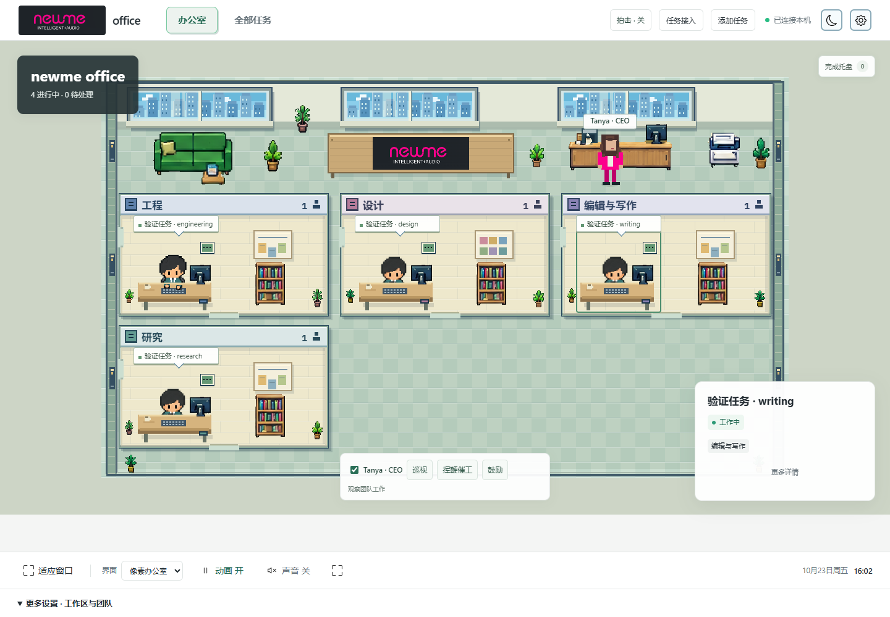

# newme office · 完整办公室 Skill

**完整办公室，不是简笔画交互演示。** 保留本机版本的两套 UI、NEWME 品牌场景、员工与 Tanya 动画、任务展示、拍击惨叫和鼓掌。无需 GPT / Codex 账号，无需 API Key。

| 现代办公室 | 像素办公室 |
| --- | --- |
|  |  |

图片来自此完整包的独立安装验证；图中任务是虚构测试任务。

## 给朋友 / AI 助手

把这段话连同链接发给支持 SKILL.md 的助手：

> 安装公开仓库 https://github.com/69755354/newme 中的 skills/newme-office。按 SKILL.md 在我的工作目录安装并运行完整办公室，保留现代和像素两种视图、人物动画、任务展示、拍击惨叫和鼓掌，不要换成 newme-interactions 演示版。任务先用手动管理或 JSON / CLI 接入；麦克风由我在页面里开启。

公开地址：<https://github.com/69755354/newme/tree/main/skills/newme-office>

也可下载仓库，把整个 `skills/newme-office` 文件夹放进你使用的工具要求的 skills 目录。必须复制整个文件夹，不能只拿 `SKILL.md`。具体安装入口由你的助手决定；本包不依赖 OpenAI。支持技能名称调用的工具可用 `$newme-office`。

## 不用 AI 助手也能运行

安装 Node.js 22 或更新版本，然后：

```sh
git clone https://github.com/69755354/newme.git
cd newme/skills/newme-office/assets/app
npm start
```

打开 **http://127.0.0.1:4319/**。无需 `npm install`。Windows 也可双击应用目录中的 `start-windows.cmd`；macOS / Linux 可运行 `sh start-macos.command`。Ctrl+C 停止服务。

**从旧演示版更新：** 在仓库里执行 `git pull`，然后按上面路径进入 `skills/newme-office/assets/app` 再启动。旧的 `skills/newme-interactions` 和端口 `4320` 仍是交互演示模块；完整办公室使用这里的 `newme-office`，默认端口为 `4319`。

## 完整内容

- **两套视图：** 现代空间和像素办公室，页面底部及全屏内可切换；刷新保留选择。
- **人物动画：** 工程、设计、研究、写作员工；Tanya 观察、巡视、挥鞭催工和鼓励。人物贴图与办公室美术随包提供。
- **任务展示：** 名称、部门、项目、来源、状态、筛选、选定任务、完成托盘和按任务轮次显示的交付内容。一个任务对应一个员工，多部门不重复增加员工；两套视图共用分页。
- **拍击惨叫：** 在办公室页面内主动开启麦克风后识别短促冲击声，在本地触发动作和电子卡通惨叫。
- **鼓掌：** 「鼓励」播放掌声并触发动画；可试听、静音和调整音量。
- **设置：** 页面向下滚动有更多工作区与团队设置，齿轮内有外观、声音和动画等设置。

第一次运行有明确标注的示例任务，只用于体验完整场景，不是 AI 真在工作。在添加/编辑任务窗口点「移除示例任务」，再添加自己的任务；或在新的数据目录用 `node server.mjs --empty` 从空办公室开始。

## 非 GPT 环境怎么接任务

这版已经有**实际可用**的通用任务连接层：

1. 页面上手动添加/编辑任务，不需要任何 AI 软件。
2. 让你的工具写 `.newme-office/tasks.json`，办公室约两秒读取一次。
3. 让工具运行 `node scripts/tasks.mjs upsert ...` 更新任务。
4. 使用带本机令牌认证的 HTTP 接口发布任务与状态。

例如，在运行办公室的应用目录另开终端：

```sh
node scripts/tasks.mjs upsert --id my-work --title "开发网站" --status working --role engineering --provider "我的工具"
node scripts/tasks.mjs upsert --id my-work --status done --reply "已经完成并核验，交付地址见项目文件。"
```

以上命令更新展示状态和交付内容；不会自行调用模型。Claude Code、Cursor、自建 Agent 或普通脚本可通过它们实际支持的脚本/API能力发布事件。本包不会凭空自动监听所有软件；需要让你的工具使用这些接口。具体字段、HTTP 接入和返工反馈见 [INTEGRATION.md](assets/app/INTEGRATION.md)。

## 数据和麦克风

本机服务只监听 `127.0.0.1`。任务、API 令牌、选择和反馈回执保存在启动目录的 `.newme-office/`；升级时保留它，不要提交到 Git。视图、声音和角色偏好保存在浏览器。原始照片、私人会话、登录状态与本机真实任务不在公开包中；包含的是用户要求公开的办公室与人物动画素材。

麦克风默认关闭。识别只在页面开着且已启用时运行，不保存录音、不上传音频。启用后声音型算法可能将拍手、打字或桌面碰撞误识别；需要按设备调灵敏度，没有跨设备准确率保证。

默认返工反馈仅本机记录；连接自己的接收器后才会转发。接收成功不代表 AI 已执行。挥鞭、鼓励和试听不会发送返工要求。

## 开发和许可

在 `assets/app` 里运行 `npm test` 和 `npm run check`。安装脚本可将完整应用复制到工作目录中的新位置，拒绝覆盖已有文件。

本项目基于 [Workroom](https://github.com/mooi218/workroom) 的 MIT 源码进行改造，保留原许可；新增代码使用 MIT。完整来源与素材说明见 [THIRD_PARTY.md](assets/app/THIRD_PARTY.md)，字体和图标许可证随资源提供，合成惨叫与掌声为 CC0。
